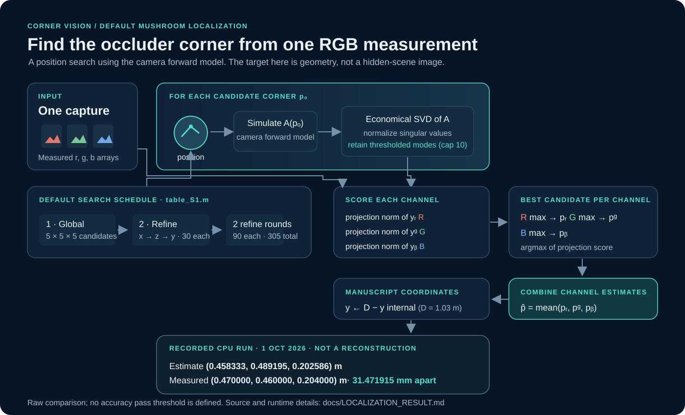

# CornerVision

**Computational periscopy with an ordinary digital camera.**

Recover a hidden scene from calibrated camera measurements using a light-transport model and image reconstruction. Explore the MATLAB source, bundled measurements and geometry helper; the [verification guide](docs/VERIFICATION.md) discloses two TV solver corrections.

[Start without a GPU](#start-without-a-gpu) · [Read a recorded result](#a-recorded-cpu-result) · [Choose an image workflow](#inputs-and-workflows) · [Source and license](#license)

## A recorded CPU result

The retained default mushroom experiment estimates the **occluder's corner position**, a separate task from recovering a scene image. A [recorded hosted run](https://github.com/nazeeh111/CornerVision/actions/runs/36885002157) completed all three localization stages on 1 October 2026 using base MATLAB:

Manuscript coordinates, in meters:

| Axis | Executed estimate | Measured corner |
| --- | --- | --- |
| x | 0.458333 | 0.470000 |
| y | 0.489195 | 0.460000 |
| z | 0.202586 | 0.204000 |

The estimate is **31.471915 mm** from the measured corner. This is a recorded raw comparison with no accuracy pass threshold, not a fresh run or an image reconstruction. [Full result, runtime, source revision and coordinate convention](docs/LOCALIZATION_RESULT.md).

### How localization works

The recorded result above comes from the occluder-position search below. It estimates a corner position; it does not recover a scene image.

<picture>
  <source media="(max-width: 600px)" srcset="docs/figures/localization-method-portrait.svg">
  
</picture>

The recorded estimate is compared with the measured corner in manuscript coordinates. The stages follow the default mushroom settings in [`table_S1.m`](table_S1.m); candidate scoring follows [`occluderposgridsearch.m`](Functions/occluderposgridsearch.m). Diagram element sources are listed in [`LOCALIZATION-FIGURE-SOURCES.md`](docs/LOCALIZATION-FIGURE-SOURCES.md).

## Start without a GPU

For a source-preservation check with Python 3 only, run from the repository root:

```bash
python3 tests/check_source_manifest.py
```

This checks the unchanged historical manifest, **163 unchanged original source/data files**, and **2 intentionally modified TV solver files** against a separately pinned [modification record](docs/SOURCE-MODIFICATIONS.json). It does not execute MATLAB or validate a reconstruction. [Correction scope and limits](docs/VERIFICATION.md#tv-solver-corrections-2026-10-23).

For the small offline MATLAB check, open MATLAB in the repository root and run:

```matlab
run('tests/smoke_test.m')
```

It checks 20 ray–plane intersections against the original helper and an analytical reference, then reads the headers of 136 bundled MAT files. No GPU or extra toolbox is needed for this check. Header readability does not validate every measurement variable. See [verification](docs/VERIFICATION.md) for recorded environments and unavailable checks.

## Geometry helper

```matlab
point = corner_vision([0 0 0], [1 2 3], [0 1 0], [0 1 0]);
% Expected point: [0.5 1 1.5]
```

The ray from `[0 0 0]` toward `[1 2 3]` intersects the plane `y = 1` halfway between those points. [`corner_vision`](corner_vision.m) forwards to the retained [`ray_plane_intersect_y`](Functions/ray_plane_intersect_y.m), preserving its arguments, errors and output. This alias computes a geometry point; it is not the image-reconstruction entry point.

## Inputs and workflows

Run the research scripts from the repository root. Choose the task before choosing a command:

| Task | Entry point | Requirements |
| --- | --- | --- |
| Occluder localization, default mushroom scene | [`table_S1.m`](table_S1.m) | CPU arrays; the recorded full run used base MATLAB. It took about 20 minutes in that hosted environment, not an ETA for your machine. |
| Scene reconstruction by differencing | [`fig4_column_c.m`](fig4_column_c.m) | Supported NVIDIA GPU and Parallel Computing Toolbox; total-variation solver also calls `nansum` from Statistics and Machine Learning Toolbox. |
| Shift-and-combine reconstruction using estimated occluder positions | [`fig4_column_d.m`](fig4_column_d.m) | Same image-reconstruction requirements. |
| Shift-and-combine reconstruction using true occluder positions | [`fig4_column_e.m`](fig4_column_e.m) | Same image-reconstruction requirements. |

The bundled [`Data/`](Data) measurements are research inputs, not newly generated results. The unchanged path configuration supports **macOS and Windows**; Linux capture paths are not configured. The image scripts allocate GPU arrays unconditionally, so CPU localization success does not establish that image reconstruction will run on a Mac without a supported NVIDIA GPU.

Supplemental image experiments are [`fig_S1_S2.m`](fig_S1_S2.m), [`fig_S9.m`](fig_S9.m), [`fig_S14.m`](fig_S14.m), [`fig_S15.m`](fig_S15.m) and [`fig_S16.m`](fig_S16.m). They share the GPU requirement. The optional `stack_combine` helper also calls `nanmedian` from Statistics and Machine Learning Toolbox.

## Verification

The [verification guide](docs/VERIFICATION.md) separates source hashes, geometry checks, one-candidate CPU checks and the full default localization. GitHub Actions runs the smoke check automatically; its manual `candidate` and `localization` modes cover different amounts of CPU work. The geometry check does not reconstruct an image. No fresh GPU reconstruction or full paper replication is claimed here.

If an image script fails at `gpuArray`, use the no-GPU entry paths above or a supported research environment. If data cannot be found, check that the current folder is the repository root and that the original macOS/Windows path branch applies. These failures are not evidence that the geometry helper can substitute for image reconstruction.

## License

[Source provenance and scope](NOTICE).

MIT covers CornerVision's added entry point, tests, documentation and artwork only. No upstream license file was present at the verified source revision; this repository's MIT terms do not grant an additional license for the original research code or measurements.
